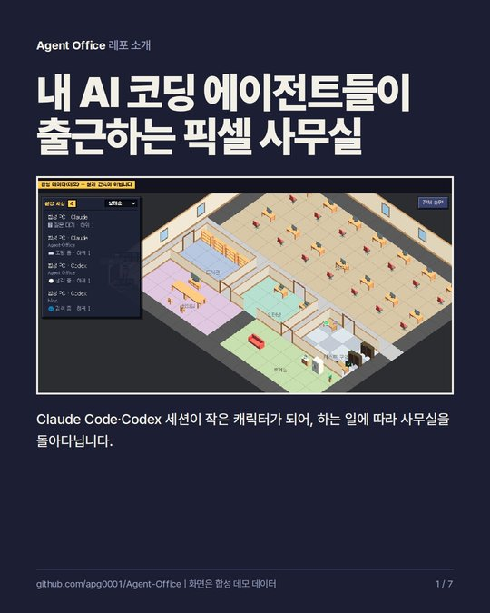
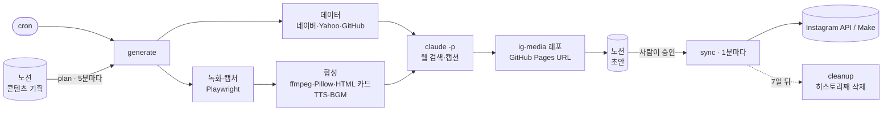

<h1 align="center">📸 instagram-auto-uploader</h1>

<p align="center">
  <b>라즈베리파이 한 대로 돌리는 개인용 인스타그램 자동 업로더</b><br>
  게임 플레이 녹화, 증시 시황 카드, 깃허브 인기 레포 릴스(음성·BGM 포함)를 알아서 만들고<br>
  <b>노션에서 사람이 승인한 것만</b> 올립니다. 무엇을 언제 만들지도 노션에 적으면 됩니다.
</p>

<p align="center">
  
  <a href="https://github.com/apg0001/instagram-auto-uploader/actions/workflows/ci.yml"></a>
  
  
  
  <a href="LICENSE"></a>
</p>

<p align="center">
  
  
  
</p>

<p align="center">
  <a href="#-무엇을-올리나">무엇을 올리나</a> ·
  <a href="#️-어떻게-돌아가나">어떻게 돌아가나</a> ·
  <a href="#-노션-대시보드">노션 대시보드</a> ·
  <a href="#-설치">설치</a> ·
  <a href="#️-명령">명령</a> ·
  <a href="#-스케줄">스케줄</a> ·
  <a href="#-구조">구조</a>
</p>

---

## 🗂 무엇을 올리나

| 소스 | 형식 | 내용 | 원칙 |
|---|---|---|---|
| 🎮 **랩워즈** (`lab-wars`, `lab-wars:<기능>`) | 릴스 · 캐러셀 | 헤드리스 브라우저가 [랩워즈](https://apg0001.github.io/lab-wars/)를 직접 플레이하며 녹화. 전체 소개 → 외전 · 장비 뽑기 · 전공 모드 · 무한 모드 순서의 소개 시리즈 | 게임과 플레이 링크만. **레포·소스코드 언급 금지** |
| 🏢 **Agent Office** (`agent-office`) | 릴스 · 카드뉴스 | 로그인 없이 보이는 **합성 데모 화면**을 녹화. 구역·상태·개인정보 원칙·설치 3단계 | 레포 링크를 꼭 넣고, 베타라는 점을 솔직하게 |
| 📈 **증시** (`market:*`) | 캐러셀 | 장 시작 전 · 장 마감 · 주간 · 월간 리포트. 업종 등락, 시총 상위, 급등·급락, 요주의 종목 | 숫자는 데이터에서만. 근거는 **출처가 있을 때만**. 면책 문구 필수 |
| ⭐ **깃허브 인기 레포** (`github-trending`) | 릴스 + 캐러셀 | GitHub Trending(주간)에서 이번 주 별 증가 Top 5. 릴스(릴스 탭): 5위→1위 카운트다운, 별 카운트업, TTS 내레이션, 매번 다른 BGM. 캐러셀(피드): 레포마다 설명·이런 분께·이런 걸 해요·통계. 레포당 공식 배지·태그·데이터로 계산한 숫자 한 줄. 매주 스냅샷으로 지난주 순위·증가량 비교 | 숫자는 데이터 그대로. 크랙·악성·코인 홍보 레포 제외 |
| 🗓 **노션 기획** (`plan`) | 카드뉴스 · 릴스 | 노션 '콘텐츠 기획' 표에 주제·주기를 대충 적으면 Claude가 다듬어 정기 시리즈로 | 다듬은 규칙을 사람이 읽고 '사용'으로 바꿔야 시작 |
| ✍️ **요청형** (`topic`, `post`) | 카드뉴스 · 무엇이든 | 주제를 주면 조사해서 카드뉴스로(일러스트 포함). 또는 준비한 파일 그대로 | 자동 승인 (반려로 취소) |

### 📈 증시 리포트

| 리포트 | 언제 | 슬라이드 |
|---|---|---|
| 장 시작 전 브리핑 | 평일 07:30 | 밤사이 미국 지수·환율 → 미국 섹터 → 빅테크 → 전 거래일 국내 업종 → 오늘 체크포인트 |
| 장 마감 시황 | 평일 16:00 | 코스피·코스닥·환율 + 장중 흐름 → 업종 등락(상위·하위) → 시총 상위 10 → 급등 → 급락 → 내일 눈여겨볼 종목 |
| 주간 리포트 | 토 09:00 | 지수 주간 수익률 → 업종 ETF 수익률 → 대형주 강세·약세 → 이번 주 이슈 → 다음 주 일정 |
| 월간 리포트 | 월말 마지막 거래일 16:40 | 주간과 같은 구성, 한 달 기준 |

- **숫자**는 네이버 증권·Yahoo Finance에서 받은 값을 코드가 카드에 직접 그립니다. 캡션·요약에 데이터에 없는 숫자가 나오면 다시 쓰게 합니다.
- **왜 올랐나·내렸나**는 `claude -p`가 웹 검색으로 기사·공시를 찾아 쓰고 출처를 붙입니다. 못 찾으면 비워 둡니다.
- 휴장일(KRX)엔 만들지 않고, 시황은 때를 놓치면 의미가 없으니 **기한이 지나면 자동 반려**됩니다(장전 브리핑은 09:00까지).

## ⚙️ 어떻게 돌아가나



1. **만들기** — 소스별로 녹화·캡처하거나 데이터를 받아 릴스(1080×1920)·캐러셀(1080×1350)을 만듭니다.
2. **글쓰기** — `claude -p`(Claude Code 헤드리스)가 캡션을 씁니다. 별도 API 키 없이 구독 사용량을 씁니다.
3. **올려 두기** — 인스타그램은 공개 URL에서 파일을 가져가므로, 미디어를 [`apg0001/ig-media`](https://github.com/apg0001/ig-media)(GitHub Pages)에 올립니다.
4. **승인** — 노션 DB에 '초안'으로 등록됩니다. 미리보기를 보고, 캡션을 고치고, 상태를 **승인** 또는 **반려**로 바꿉니다. 예약 날짜도 넣을 수 있습니다.
5. **게시** — 릴스는 릴스 탭에만(Make의 Share to Feed = No), 피드에는 캐러셀·이미지만 올라가 그리드가 겹치지 않습니다. `sync`가 승인 건을 Instagram API(또는 [Make 웹훅](docs/make.md))로 올리고 '게시됨'과 인스타 링크를 채웁니다.
6. **정리** — 게시·반려 후 7일이 지난 미디어는 ig-media에서 **히스토리째** 지웁니다. 인스타그램은 게시할 때 파일을 복사해 가므로 원본이 필요 없습니다.

### 🧊 만약에 3D 릴스

"매일 쓰는 그 돈을 그때부터 ○○에 넣었다면?" — 보는 사람 습관을 찔러 댓글을 부르는 35~45초 3D 릴스 (노션 생성기 **만약에 3D 릴스**, 토 20:00).

1. **대본 틀**: Claude가 시리즈 지침·후보 중 하나로 9박자 대본을 쓰되 **숫자는 직접 못 쓰고** `{value}` `{mdd}` 같은 자리 표시만 (어기면 다시 쓰게 함).
2. **계산**: 하루 금액 × 30일을 시작 달부터 매달 자산에 넣었다고 보고 야후 수정주가 + FRED 원/달러로 넣은 돈·지금 가치·배수·한 잔당 가치·최대 낙폭·연말 막대를 계산해 채움.
3. **소리**: 장면별 타입캐스트 내레이션(문맥 감정, 같은 문장은 `data/tts-cache` 재사용) → 장면 길이. 합성 BGM은 내레이션 때 줄임.
4. **영상**: [`video/whatif`](video/whatif) Remotion + three.js (`@remotion/three`) — 장면마다 spin·pile·growth·rise·crash·end 중 하나, 물체는 커피잔·금화. 파이에서는 `--gl=swangle`.

```bash
python -m uploader whatif --spec ep.json --at 2026-11-21T20:00   # 대본 틀을 직접 주기 (없으면 Claude가 씀)
```

### 🎨 카드 디자인

카드는 HTML(Jinja2)로 만들고 Playwright로 찍습니다. 디자인 원칙은 Anthropic이 공개한 [`anthropics/skills`](https://github.com/anthropics/skills)의 **frontend-design**, **canvas-design** 스킬(Apache-2.0, [`prompts/anthropic-skills/`](prompts/anthropic-skills))을 따릅니다.

- 증시 카드는 국내 시세 관습(상승 빨강 ▲, 하락 파랑 ▼)과 고정폭 숫자를 쓰고, 과감함은 표지 한 곳(그날 시장 방향으로 물든 배경)에만 씁니다.
- `topic --design free`는 이 스킬을 그대로 지침으로 넣어 Claude가 슬라이드 HTML을 직접 디자인합니다.
- 서체는 [Pretendard](https://github.com/orioncactus/pretendard)(OFL) 한 가족입니다.
- **주제마다 색이 고정**돼 피드에서 색만 봐도 구분됩니다 ([`uploader/themes.py`](uploader/themes.py)). 모든 카드·릴스 맨 위에 주제 색 띠가 있습니다.

| 주제 | 색 | 소스 |
|---|---|---|
| 게임 | 크림 · 주황 | 랩워즈 |
| 프로젝트 | 남색 · 노랑 | Agent Office 등 직접 만든 도구 |
| 증시 | 회색 · 먹색 (상승 빨강 / 하락 파랑) | 증시 리포트 |
| 테크·AI | 연보라 · 보라 | 깃허브 인기 레포, 요청형 주제 |
| 커리어 | 민트 · 초록 | 노션 기획에서 고른 커리어 주제 |

### 🔊 릴스 소리

- **내레이션** — [edge-tts](https://github.com/rany2/edge-tts)(무료, API 키 없음)의 한국어 음성. 비공식 엔드포인트라 막히면 음성 없이 자막·BGM만으로 만듭니다. 음성은 `config.yaml`의 `github_trending.voice`.
- **BGM** — [`uploader/bgm.py`](uploader/bgm.py)가 numpy로 직접 합성합니다. 날짜를 시드로 조성·템포·코드 진행·드럼 패턴·음색이 매번 바뀌고, 저작권 걱정이 없습니다. 목소리가 나올 때는 사이드체인으로 자동으로 작아집니다.
- 랩워즈 릴스도 같은 합성 BGM을 깝니다 (헤드리스 녹화에는 게임 소리가 담기지 않음).

### ✍️ 캡션 원칙

첫 줄은 검색될 만한 키워드를 담은 훅, 해시태그는 **4~5개**(고유 1 + 주제 2~3 + 대상 1)만. 8개를 넘으면 다시 씁니다.

## 📋 노션 대시보드

`notion-dashboard` 한 번이면 아래 구조가 만들어집니다(여러 번 실행해도 안전). 홈에는 요약만, 표는 하위 페이지에 하나씩.

```text
🏠 인스타그램 운영
 ├ 📌 오늘 요약        오늘 남은 게시 + 할 일(확인할 초안·실패·검토 대기 시리즈·정리 중 아이디어)
 ├ 🗓 이번 주 올라갈 것  오늘~일요일 표: 날짜·시각·무엇·상태(준비됨·초안·만들 예정·증시 자동) — plan 때마다 갱신
 ├ 📥 게시물           게시물 표
 ├ 🧭 시리즈 기획       콘텐츠 기획 표 + 쓰는 법
 ├ 💡 아이디어 수신함    한 줄 적으면 Claude가 기존 시리즈의 다음 회차 후보로 넣거나 새 시리즈 요청을 만듦
 ├ 🕒 주간 타임테이블
 └ 📖 운영 설명서       매일 일어나는 일 · 내가 할 일 · 콘텐츠 규칙 · Make 실행 기록 링크
```

**게시물 표의 보기(탭)** — 2주 지난 게시됨·반려는 '보관'에 체크돼 🗄 보관함에만 보입니다.

| 탭 | 무엇 |
|---|---|
| 📥 확인할 것 | 초안 · 실패 (자동 승인이라 사람이 볼 것만) |
| 🗓 주간 예약 | 초안·승인 게시물을 예약 시각 타임라인으로 (노션에서 확대를 '주'로 한 번 바꿔 두기) |
| 📅 예약 달력 | '예약' 날짜 기준 달력 |
| 🖼 게시됨 | 최근 올라간 것 썸네일 갤러리 |
| 📋 전체 | 보관 안 된 전체, 최신순 |
| 🗄 보관함 | 2주 지난 게시됨 · 반려 |

**💡 아이디어 수신함** — 아이디어 칸에 한 줄만. `plan`이 Claude로 읽어 기존 시리즈에 맞으면 그 시리즈 '다듬은 규칙' 끝의
`# 다음 회차 후보` 목록에 넣고(원고 지침에 함께 넘어감), 새 기획감이면 🧭 시리즈 기획에 '새 요청' 줄을 만들고, 애매하면 '보류'와 이유를 남깁니다.
댓글에서 모은 아이디어(`engagement`)도 출처 '댓글'로 여기에 들어옵니다.

**콘텐츠 기획 표**가 있습니다. `notion-dashboard` 한 번이면 보기와 기획 표가 만들어집니다(여러 번 실행해도 안전).

**게시물 표의 보기(탭)** — 상태만 바꾸면 알아서 다른 탭으로 옮겨 갑니다.

| 탭 | 무엇 |
|---|---|
| 📥 확인할 것 | 초안 · 승인 · 실패 — 매일 여기만 보면 됨 |
| 📅 예약 달력 | '예약' 날짜 기준 달력 |
| 🗓 주간 예약 | 초안·승인 게시물을 예약 시각 타임라인으로 (노션에서 확대를 '주'로 한 번 바꿔 두기) |
| 🖼 게시됨 | 올라간 것 썸네일 갤러리 |
| 🗂 주제별 | 게임 · 프로젝트 · 증시 · 테크·AI · 커리어 보드 |
| 🗑 반려 | 반려된 것 |
| 📋 전체 | 최신순 전체 |

**콘텐츠 기획 표** — 코드 수정 없이 새 시리즈를 만듭니다.

```text
새 요청  : '메모'에 대충 적기   예) 깃허브 인기 레포 top5 매주 일요일 아침, 지난주 대비
   ↓  (plan, 5분 안)
검토 대기 : Claude가 이름·주제·주기·요일·게시 시각·'다듬은 규칙'·'확인할 점'을 채움 (계정 규칙 반영)
   ↓  (사람이 읽고 상태 변경)
사용      : '다음 게시' 5시간 전에 초안 1개 → 게시물 표, '예약'은 다음 게시 시각
            (미리 승인해 두면 그 시각에 게시)
일시중지 · 완료(한 번짜리, 또는 '횟수'를 채움) · 오류
```

- '생성기'로 만드는 방법을 고릅니다: **웹 조사 카드뉴스**(기본, `claude -p` 웹 검색) / **깃허브 트렌딩 릴스** / **랩워즈 플레이 릴스** / **Agent Office 소개**.
- 웹 조사 카드뉴스는 같은 시리즈가 이미 다룬 게시물 제목을 원고 지침에 넘겨 주제가 겹치지 않게 합니다.
- **실제 화면**: 원고를 쓰는 Claude가 실제로 열어 본 공개 페이지(공식 문서·깃허브 레포·릴리스 노트) 주소를 0~2개 고르면, 휴대폰 폭으로 찍어 '실제 화면' 카드로 해당 장 뒤에 끼웁니다(`shots.py`, https 공인 주소만, 떠 있는 쿠키 배너는 숨김).
- 웹 조사 카드뉴스 카드(`story` 템플릿): 표지는 시리즈 이름 배지 + 다룰 것 번호 목록, 장마다 Claude가 내용에 맞춰 그린 플랫 일러스트(인라인 SVG, 주제 색 팔레트)를 남는 아래 공간에 넣습니다. SVG는 허용 태그·속성만 남겨 다시 만들고(스크립트·외부 참조 제거), 실패하면 일러스트 없이 나옵니다.
- '횟수'를 적으면 그만큼 만들고 완료되며, '이어서'에 적은 이름의 줄이 '사용'으로 바뀝니다 (예: 증시 용어 20편 → AI 용어).
- 게시 칸: 평일 12:00·20:00 (07:30·16:00은 증시), 주말 09:00·12:00·16:00·20:00 — 하루 4개.
- **🕒 주간 타임테이블** 표는 증시 크론·기획 표·단발 예약을 모아 `plan`이 바뀔 때마다 다시 씁니다. 손으로 고치지 말고 기획 표를 고치세요.
- 메모를 고쳐 다시 다듬으려면 상태를 '새 요청'으로 되돌리면 됩니다.

## 🚀 설치

```bash
sudo apt install -y python3.12-venv ffmpeg fonts-noto-cjk libatomic1
python3 -m venv .venv
.venv/bin/pip install -r requirements.txt
.venv/bin/python -m playwright install --with-deps chromium
git clone https://github.com/apg0001/ig-media.git media-repo
cp .env.example .env    # 토큰 채우기
```

`claude`(Claude Code)가 로그인돼 있어야 캡션·분석을 만들 수 있습니다.

<details>
<summary><b>📝 노션 연결</b></summary>

1. https://www.notion.so/profile/integrations 에서 **내부 통합**을 만들고 시크릿을 `.env`의 `NOTION_TOKEN`에 넣습니다.
2. 게시물 DB를 둘 노션 페이지를 하나 만들고, 오른쪽 위 `···` → **연결** → 방금 만든 통합을 추가합니다.
3. DB 만들기:

   ```bash
   .venv/bin/python -m uploader notion-setup "<그 페이지 URL>"
   .venv/bin/python -m uploader notion-dashboard     # 보기 + 콘텐츠 기획 표
   ```

| 속성 | 쓰임 |
|---|---|
| 상태 | `초안` → `승인` / `반려` → `게시됨` / `실패` |
| 캡션 | 여기서 고치면 고친 대로 게시 |
| 미디어 · 본문 | 미리보기 |
| 주제 | 카드 색과 같은 분류 (자동) |
| 예약 | 비워 두면 승인 즉시, 날짜를 넣으면 그때 |
| 인스타 링크 · 오류 | 게시 결과 |

</details>

<details>
<summary><b>📷 인스타그램 연결</b></summary>

1. 인스타 계정을 **프로페셔널(비즈니스 권장)** 로 바꿉니다. 스토리 API는 비즈니스 계정 기준입니다.
2. [Meta 개발자](https://developers.facebook.com) 앱 → Instagram API(Instagram 로그인) → 계정을 테스터로 추가 → **액세스 토큰 생성**.
3. `.env`에 `IG_USER_ID`, `IG_ACCESS_TOKEN`을 넣고 `config.yaml`의 `instagram.enabled`를 `true`로.

개인 계정 하나에만 올리므로 App Review는 필요 없습니다. 연동 전에는 승인된 게시물이 '승인' 상태로 기다립니다. 장기 토큰(60일)은 매주 자동 갱신합니다.

**Meta 개발자 등록이 막혔다면** — `instagram.mode: make` 로 [Make](https://www.make.com) 웹훅을 거쳐 게시할 수 있습니다. 개발자 앱 대신 페이스북 페이지 연결만 필요합니다. → [docs/make.md](docs/make.md)

</details>

## ⌨️ 명령

```bash
python -m uploader generate --source lab-wars [--kind REELS|CAROUSEL] [--stage 3-10]
python -m uploader generate --source agent-office [--kind REELS|CAROUSEL]
python -m uploader generate --source lab-wars:overview --at 2026-11-19T19:00   # 소개 시리즈 + 예약
python -m uploader generate --source market:close      # premarket | close | weekly | monthly
python -m uploader generate --source github-trending   # 깃허브 인기 레포 Top 5 릴스

python -m uploader topic "이번 주 AI 반도체 이슈 정리" [--design free]
python -m uploader generate --source lab-wars:gear|major|endless --at 2026-11-20T20:00   # 랩워즈 소개 시리즈
python -m uploader post a.jpg b.jpg --title "제목" --caption-file caption.txt

python -m uploader sync          # 노션 결정 반영 → 기한 지난 건 반려 → 승인 건 게시
python -m uploader plan          # 노션 콘텐츠 기획: 새 요청 다듬기 + 때가 된 시리즈 초안 1개
python -m uploader notion-setup <페이지>   # 게시물 표 만들기 (처음 한 번)
python -m uploader notion-dashboard       # 홈 요약 + 하위 페이지(게시물·시리즈 기획·아이디어 수신함·타임테이블·설명서)
python -m uploader engagement             # 좋아요·댓글 수 → 노션, 댓글 속 아이디어 → 아이디어 수신함 (config engagement)
python -m uploader list
python -m uploader approve <id>  # 노션 없이 (reject도 있음)
python -m uploader cleanup
python -m uploader refresh-token
```

> 💬 **대화로 요청하기** — Claude Code에 "이거 조사해서 올려 줘"라고 하면 조사·카드 제작 후 `post`로 노션 초안을 만들어 둡니다. 승인은 똑같이 노션에서.

## ⏰ 스케줄

[`deploy/crontab`](deploy/crontab) — `crontab deploy/crontab` 으로 설치합니다.

| 시각 (KST) | 작업 |
|---|---|
| 평일 07:30 | 장 시작 전 브리핑 |
| 평일 16:00 | 장 마감 시황 |
| 평일 16:40 | 월간 리포트 (월말 마지막 거래일에만) |
| 토 09:00 | 주간 리포트 |
| 5분마다 | `plan` — 노션 콘텐츠 기획 (게시 칸 12:00·20:00, 주말 09·12·16·20시) |
| 1분마다 | `sync` |
| 매일 21:15 | `engagement` (켜 둔 경우, docs/make.md 5번) |
| 매일 04:30 | `cleanup` |
| 월 05:00 | `refresh-token` |

그 밖의 정기 게시물(기술 브리핑·논문 픽·깃허브 Top 5·랩워즈·Agent Office 등)은 모두 노션 콘텐츠 기획 표에서 돌립니다.
깃허브 Top 5는 캐러셀이 게시 시각에, 릴스가 8시간 뒤(`github_trending.reel_offset_hours`)에 올라갑니다.
무거운 생성 작업은 `nice -n 19`로 돌리고, 한 번에 하나만 돕니다(파이 전원 한계).

## 🧱 구조

```text
uploader/
  sources/lab_wars.py      🎮 랩워즈 녹화 (쇼케이스 저장 주입, 봇 플레이, 미니맵으로 카메라 추적)
  sources/lab_wars_tour.py 🎮 랩워즈 소개 시리즈 캡처 (전체 소개 등)
  sources/agent_office.py  🏢 Agent Office 합성 데모 녹화 (로그인 상태면 중단)
  sources/github_trending.py ⭐ GitHub Trending 주간 수집·스냅샷·지난주 비교
  github_reel.py           ⭐ 깃허브 Top 5 릴스 장면·내레이션·믹스
  tts.py                   🗣 edge-tts 한국어 내레이션
  bgm.py                   🎵 시드별 BGM 합성
  themes.py                🎨 주제별 카드 색
  planner.py               🗓 노션 대시보드 보기 + 콘텐츠 기획 (다듬기·주기 실행)
  whatif.py                🧊 만약에 3D 릴스 (계산·대본 틀·내레이션·Remotion 렌더)
  typecast.py              🗣 타입캐스트 내레이션 (캐시, 실패 시 edge-tts)
  timetable.py             🕒 노션 주간 타임테이블 (증시 크론 + 기획 표 + 단발 예약 → 시각×요일 표)
  workspace.py             🏠 노션 홈 요약·하위 페이지·보관함·아이디어 수신함 정리
  shots.py                 🖥 '실제 화면' 카드 (공개 웹페이지 캡처)
  engagement.py            💬 좋아요·댓글 수 수집, 댓글 속 아이디어 → 수신함
  market/data.py           📈 시세 수집 (네이버 증권·Yahoo Finance·KRX 휴장일)
  market/analysis.py       🔎 claude -p 웹 검색 분석 + 숫자·이름·면책 검증
  market/report.py         🧾 리포트별 슬라이드 구성
  cards/                   🎨 HTML 카드 템플릿과 렌더러
  compose.py               🎬 릴스·캐러셀 합성 (ffmpeg·Pillow)
  caption.py               ✍️ 캡션 생성·검증
  custom.py                🧩 요청형 게시물 (topic · post)
  media_host.py            ☁️ ig-media 업로드·Pages 대기·히스토리 정리
  notion.py                📝 노션 DB·초안·승인
  instagram.py             📷 Instagram Graph API 게시·토큰 갱신
  make_webhook.py          🔗 Make 웹훅 게시 (개발자 계정 없이)
  pipeline.py              🔁 전체 흐름
prompts/anthropic-skills/  📐 디자인 지침 (Apache-2.0, 출처 그대로)
assets/fonts/              🔤 Pretendard (OFL)
config.yaml                ⚙️ 설정 (비밀 값은 .env)
```

## 🛡 안전장치

- **지금은 전부 자동 승인입니다** (`config.yaml`의 `auto_approve: ["*"]`). 초안이 노션에 '승인'으로 올라가고, 예약 시각(없으면 다음 sync)에 게시됩니다. 그 전에 노션에서 '반려'로 바꾸면 취소됩니다. 접두어 목록(예: `[market]`)으로 바꾸면 그 소스만 자동 승인하고 나머지는 사람 승인을 기다립니다.
- 노션 기획 시리즈는 게시 5시간 전에 초안이 만들어지므로, 그 사이에 확인하고 반려할 수 있습니다.
- Make 웹훅이 시간 초과되거나 결과를 못 받으면 '실패'로 남기고 자동 재시도하지 않습니다(중복 게시 방지).
- 게시 직전에 캡션을 다시 검사합니다(노션에서 고친 것 포함): 필수 링크, 금지 표현, 면책 문구.
- 증시 글은 매수·매도 권유 표현을 막고, 데이터에 없는 숫자·종목명을 거부합니다.
- Agent Office 녹화는 로그인하지 않은 브라우저로만 하고, 데모(합성 데이터) 화면이 아니면 멈춥니다.
- 토큰은 `.env`에만 두고 커밋하지 않습니다.

## 🧑‍💻 개발

```bash
.venv/bin/pip install -r requirements-dev.txt
.venv/bin/ruff check .
.venv/bin/pytest
```

Issue → `develop`에서 `feat/#번호-설명` 브랜치 → PR → `CI Gate` 통과 후 병합. 자세한 규칙은 [CONTRIBUTING.md](CONTRIBUTING.md).

## 📄 라이선스

이 레포의 코드는 [MIT](LICENSE)입니다. 함께 들어 있는 서드파티는 각자의 라이선스를 따릅니다.


| 무엇 | 라이선스 |
|---|---|
| [anthropics/skills](https://github.com/anthropics/skills) — frontend-design, canvas-design | Apache-2.0 (`prompts/anthropic-skills/*/LICENSE.txt`) |
| [Pretendard](https://github.com/orioncactus/pretendard) | SIL OFL 1.1 (`assets/fonts/LICENSE-Pretendard.txt`) |
| 시세 데이터 | 네이버 증권, Yahoo Finance — 정보 제공 목적, 투자 권유 아님 |
| [edge-tts](https://github.com/rany2/edge-tts) | LGPL-3.0 (pip 의존성). 음성은 Microsoft Edge 읽어주기 서비스 |
| 깃허브 레포 정보 | GitHub Trending 페이지·공개 API — 레포 이름·설명·별 수만 사용 |
