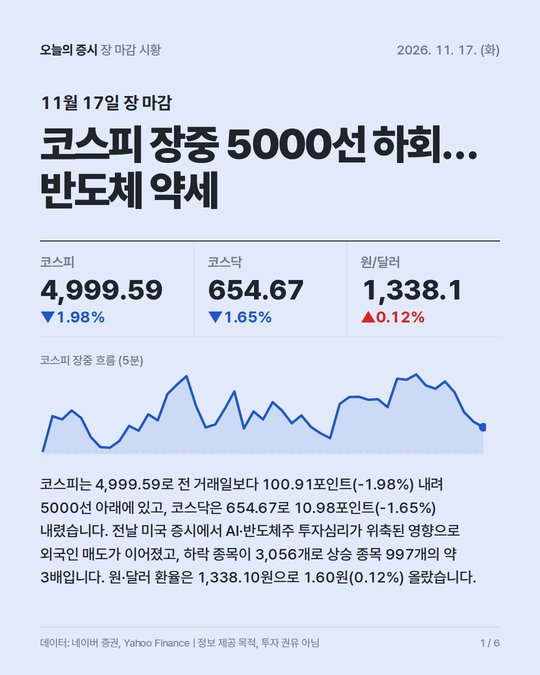
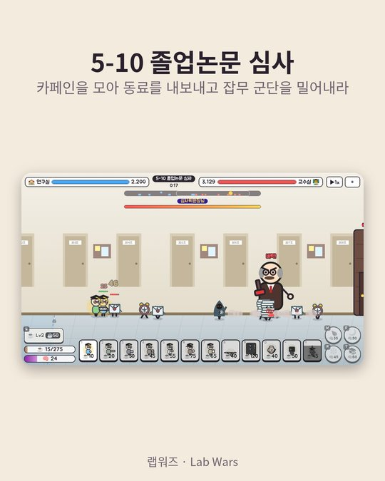
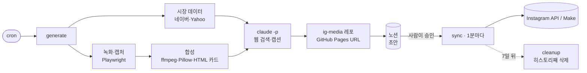

<h1 align="center">📸 instagram-auto-uploader</h1>

<p align="center">
  <b>라즈베리파이 한 대로 돌리는 개인용 인스타그램 자동 업로더</b><br>
  게임 플레이 녹화, 증시 시황 카드, 레포 소개 카드뉴스를 알아서 만들고<br>
  <b>노션에서 사람이 승인한 것만</b> 올립니다.
</p>

<p align="center">
  
  <a href="https://github.com/apg0001/instagram-auto-uploader/actions/workflows/ci.yml"></a>
  
  
  
  <a href="LICENSE"></a>
</p>

<p align="center">
  
  
  
</p>

<p align="center">
  <a href="#-무엇을-올리나">무엇을 올리나</a> ·
  <a href="#️-어떻게-돌아가나">어떻게 돌아가나</a> ·
  <a href="#-설치">설치</a> ·
  <a href="#️-명령">명령</a> ·
  <a href="#-스케줄">스케줄</a> ·
  <a href="#-구조">구조</a>
</p>

---

## 🗂 무엇을 올리나

| 소스 | 형식 | 내용 | 원칙 |
|---|---|---|---|
| 🎮 **랩워즈** (`lab-wars`) | 릴스 · 캐러셀 | 헤드리스 브라우저가 [랩워즈](https://apg0001.github.io/lab-wars/)를 직접 플레이하며 녹화. 보스전·스토리 컷신·스테이지 지도 | 게임과 플레이 링크만. **레포·소스코드 언급 금지** |
| 🏢 **Agent Office** (`agent-office`) | 릴스 · 카드뉴스 | 로그인 없이 보이는 **합성 데모 화면**을 녹화. 구역·상태·개인정보 원칙·설치 3단계 | 레포 링크를 꼭 넣고, 베타라는 점을 솔직하게 |
| 📈 **증시** (`market:*`) | 캐러셀 | 장 시작 전 · 장 마감 · 주간 · 월간 리포트. 업종 등락, 시총 상위, 급등·급락, 요주의 종목 | 숫자는 데이터에서만. 근거는 **출처가 있을 때만**. 면책 문구 필수 |
| ✍️ **요청형** (`topic`, `post`) | 카드뉴스 · 무엇이든 | 주제를 주면 조사해서 카드뉴스로. 또는 준비한 파일 그대로 | 사람이 승인 |

### 📈 증시 리포트

| 리포트 | 언제 | 슬라이드 |
|---|---|---|
| 장 시작 전 브리핑 | 평일 07:30 | 밤사이 미국 지수·환율 → 미국 섹터 → 빅테크 → 전 거래일 국내 업종 → 오늘 체크포인트 |
| 장 마감 시황 | 평일 16:00 | 코스피·코스닥·환율 + 장중 흐름 → 업종 등락(상위·하위) → 시총 상위 10 → 급등 → 급락 → 내일 눈여겨볼 종목 |
| 주간 리포트 | 토 09:00 | 지수 주간 수익률 → 업종 ETF 수익률 → 대형주 강세·약세 → 이번 주 이슈 → 다음 주 일정 |
| 월간 리포트 | 월말 마지막 거래일 16:40 | 주간과 같은 구성, 한 달 기준 |

- **숫자**는 네이버 증권·Yahoo Finance에서 받은 값을 코드가 카드에 직접 그립니다. 캡션·요약에 데이터에 없는 숫자가 나오면 다시 쓰게 합니다.
- **왜 올랐나·내렸나**는 `claude -p`가 웹 검색으로 기사·공시를 찾아 쓰고 출처를 붙입니다. 못 찾으면 비워 둡니다.
- 휴장일(KRX)엔 만들지 않고, 시황은 때를 놓치면 의미가 없으니 **기한이 지나면 자동 반려**됩니다(장전 브리핑은 09:00까지).

## ⚙️ 어떻게 돌아가나



1. **만들기** — 소스별로 녹화·캡처하거나 데이터를 받아 릴스(1080×1920)·캐러셀(1080×1350)을 만듭니다.
2. **글쓰기** — `claude -p`(Claude Code 헤드리스)가 캡션을 씁니다. 별도 API 키 없이 구독 사용량을 씁니다.
3. **올려 두기** — 인스타그램은 공개 URL에서 파일을 가져가므로, 미디어를 [`apg0001/ig-media`](https://github.com/apg0001/ig-media)(GitHub Pages)에 올립니다.
4. **승인** — 노션 DB에 '초안'으로 등록됩니다. 미리보기를 보고, 캡션을 고치고, 상태를 **승인** 또는 **반려**로 바꿉니다. 예약 날짜도 넣을 수 있습니다.
5. **게시** — `sync`가 승인 건을 Instagram API로 올리고 '게시됨'과 인스타 링크를 채웁니다.
6. **정리** — 게시·반려 후 7일이 지난 미디어는 ig-media에서 **히스토리째** 지웁니다. 인스타그램은 게시할 때 파일을 복사해 가므로 원본이 필요 없습니다.

### 🎨 카드 디자인

카드는 HTML(Jinja2)로 만들고 Playwright로 찍습니다. 디자인 원칙은 Anthropic이 공개한 [`anthropics/skills`](https://github.com/anthropics/skills)의 **frontend-design**, **canvas-design** 스킬(Apache-2.0, [`prompts/anthropic-skills/`](prompts/anthropic-skills))을 따릅니다.

- 증시 카드는 국내 시세 관습(상승 빨강 ▲, 하락 파랑 ▼)과 고정폭 숫자를 쓰고, 과감함은 표지 한 곳(그날 시장 방향으로 물든 배경)에만 씁니다.
- `topic --design free`는 이 스킬을 그대로 지침으로 넣어 Claude가 슬라이드 HTML을 직접 디자인합니다.
- 서체는 [Pretendard](https://github.com/orioncactus/pretendard)(OFL) 한 가족입니다.

## 🚀 설치

```bash
sudo apt install -y python3.12-venv ffmpeg fonts-noto-cjk libatomic1
python3 -m venv .venv
.venv/bin/pip install -r requirements.txt
.venv/bin/python -m playwright install --with-deps chromium
git clone https://github.com/apg0001/ig-media.git media-repo
cp .env.example .env    # 토큰 채우기
```

`claude`(Claude Code)가 로그인돼 있어야 캡션·분석을 만들 수 있습니다.

<details>
<summary><b>📝 노션 연결</b></summary>

1. https://www.notion.so/profile/integrations 에서 **내부 통합**을 만들고 시크릿을 `.env`의 `NOTION_TOKEN`에 넣습니다.
2. 게시물 DB를 둘 노션 페이지를 하나 만들고, 오른쪽 위 `···` → **연결** → 방금 만든 통합을 추가합니다.
3. DB 만들기:

   ```bash
   .venv/bin/python -m uploader notion-setup "<그 페이지 URL>"
   ```

| 속성 | 쓰임 |
|---|---|
| 상태 | `초안` → `승인` / `반려` → `게시됨` / `실패` |
| 캡션 | 여기서 고치면 고친 대로 게시 |
| 미디어 · 본문 | 미리보기 |
| 예약 | 비워 두면 승인 즉시, 날짜를 넣으면 그때 |
| 인스타 링크 · 오류 | 게시 결과 |

</details>

<details>
<summary><b>📷 인스타그램 연결</b></summary>

1. 인스타 계정을 **프로페셔널(비즈니스 권장)** 로 바꿉니다. 스토리 API는 비즈니스 계정 기준입니다.
2. [Meta 개발자](https://developers.facebook.com) 앱 → Instagram API(Instagram 로그인) → 계정을 테스터로 추가 → **액세스 토큰 생성**.
3. `.env`에 `IG_USER_ID`, `IG_ACCESS_TOKEN`을 넣고 `config.yaml`의 `instagram.enabled`를 `true`로.

개인 계정 하나에만 올리므로 App Review는 필요 없습니다. 연동 전에는 승인된 게시물이 '승인' 상태로 기다립니다. 장기 토큰(60일)은 매주 자동 갱신합니다.

**Meta 개발자 등록이 막혔다면** — `instagram.mode: make` 로 [Make](https://www.make.com) 웹훅을 거쳐 게시할 수 있습니다. 개발자 앱 대신 페이스북 페이지 연결만 필요합니다. → [docs/make.md](docs/make.md)

</details>

## ⌨️ 명령

```bash
python -m uploader generate --source lab-wars [--kind REELS|CAROUSEL] [--stage 3-10]
python -m uploader generate --source agent-office [--kind REELS|CAROUSEL]
python -m uploader generate --source market:close      # premarket | close | weekly | monthly

python -m uploader topic "이번 주 AI 반도체 이슈 정리" [--design free]
python -m uploader post a.jpg b.jpg --title "제목" --caption-file caption.txt

python -m uploader sync          # 노션 결정 반영 → 기한 지난 건 반려 → 승인 건 게시
python -m uploader list
python -m uploader approve <id>  # 노션 없이 (reject도 있음)
python -m uploader cleanup
python -m uploader refresh-token
```

> 💬 **대화로 요청하기** — Claude Code에 "이거 조사해서 올려 줘"라고 하면 조사·카드 제작 후 `post`로 노션 초안을 만들어 둡니다. 승인은 똑같이 노션에서.

## ⏰ 스케줄

[`deploy/crontab`](deploy/crontab) — `crontab deploy/crontab` 으로 설치합니다.

| 시각 (KST) | 작업 |
|---|---|
| 평일 07:30 | 장 시작 전 브리핑 |
| 평일 16:00 | 장 마감 시황 |
| 평일 16:40 | 월간 리포트 (월말 마지막 거래일에만) |
| 토 09:00 | 주간 리포트 |
| 화·금 12:00 | 랩워즈 |
| 수 12:00 | Agent Office |
| 1분마다 | `sync` |
| 매일 04:30 | `cleanup` |
| 월 05:00 | `refresh-token` |

## 🧱 구조

```text
uploader/
  sources/lab_wars.py      🎮 랩워즈 녹화 (쇼케이스 저장 주입, 봇 플레이, 미니맵으로 카메라 추적)
  sources/agent_office.py  🏢 Agent Office 합성 데모 녹화 (로그인 상태면 중단)
  market/data.py           📈 시세 수집 (네이버 증권·Yahoo Finance·KRX 휴장일)
  market/analysis.py       🔎 claude -p 웹 검색 분석 + 숫자·이름·면책 검증
  market/report.py         🧾 리포트별 슬라이드 구성
  cards/                   🎨 HTML 카드 템플릿과 렌더러
  compose.py               🎬 릴스·캐러셀 합성 (ffmpeg·Pillow)
  caption.py               ✍️ 캡션 생성·검증
  custom.py                🧩 요청형 게시물 (topic · post)
  media_host.py            ☁️ ig-media 업로드·Pages 대기·히스토리 정리
  notion.py                📝 노션 DB·초안·승인
  instagram.py             📷 Instagram Graph API 게시·토큰 갱신
  make_webhook.py          🔗 Make 웹훅 게시 (개발자 계정 없이)
  pipeline.py              🔁 전체 흐름
prompts/anthropic-skills/  📐 디자인 지침 (Apache-2.0, 출처 그대로)
assets/fonts/              🔤 Pretendard (OFL)
config.yaml                ⚙️ 설정 (비밀 값은 .env)
```

## 🛡 안전장치

- **승인 없이는 아무것도 올라가지 않습니다.** 노션에서 사람이 승인해야 게시됩니다.
- 게시 직전에 캡션을 다시 검사합니다(노션에서 고친 것 포함): 필수 링크, 금지 표현, 면책 문구.
- 증시 글은 매수·매도 권유 표현을 막고, 데이터에 없는 숫자·종목명을 거부합니다.
- Agent Office 녹화는 로그인하지 않은 브라우저로만 하고, 데모(합성 데이터) 화면이 아니면 멈춥니다.
- 토큰은 `.env`에만 두고 커밋하지 않습니다.

## 🧑‍💻 개발

```bash
.venv/bin/pip install -r requirements-dev.txt
.venv/bin/ruff check .
.venv/bin/pytest
```

Issue → `develop`에서 `feat/#번호-설명` 브랜치 → PR → `CI Gate` 통과 후 병합. 자세한 규칙은 [CONTRIBUTING.md](CONTRIBUTING.md).

## 📄 라이선스

이 레포의 코드는 [MIT](LICENSE)입니다. 함께 들어 있는 서드파티는 각자의 라이선스를 따릅니다.


| 무엇 | 라이선스 |
|---|---|
| [anthropics/skills](https://github.com/anthropics/skills) — frontend-design, canvas-design | Apache-2.0 (`prompts/anthropic-skills/*/LICENSE.txt`) |
| [Pretendard](https://github.com/orioncactus/pretendard) | SIL OFL 1.1 (`assets/fonts/LICENSE-Pretendard.txt`) |
| 시세 데이터 | 네이버 증권, Yahoo Finance — 정보 제공 목적, 투자 권유 아님 |
